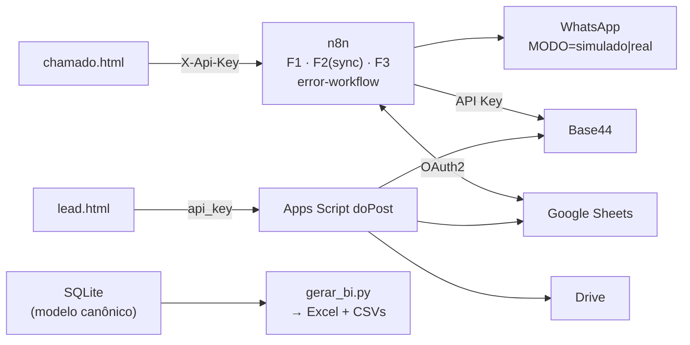

# AureaOps — Central de Atendimento, Leads e Relatórios

**Online:** [demonstração na Vercel](https://aureaops.vercel.app) ·
repositório: [github.com/yurifp/aureaops](https://github.com/yurifp/aureaops)

Projeto de portfólio para vaga de **Analista de Automação e Integração**
(Comercial · Marketing · SAC · BI). Empresa fictícia: **Aurea Home**, loja
virtual de casa e decoração. Todos os dados, pessoas e contatos são fictícios
(domínios `@example.com`/`@aureahome.example`, DDD 00).

**Três fluxos, ponta a ponta:**

| Fluxo | O que faz | Stack |
|---|---|---|
| **F1 — SAC** | Formulário → webhook n8n → validação → vínculo com pedido → Sheets + Base44 → aviso ao atendente (WhatsApp simulado + e-mail) → verificação de SLA a cada hora com escalonamento (alta 4h · média 24h · baixa 72h) | n8n, Sheets (OAuth2), Base44 (API Key) |
| **F2 — Leads** | Formulário com UTM → Apps Script (`doPost`) → Sheets + Drive → round-robin entre vendedores → espelho no Base44 com retry → follow-up D+1/D+3 por trigger diária | Apps Script, Sheets, Drive, Base44 |
| **F3 — BI e alertas** | Resumo diário (07:00) e semanal (seg 07:30) por e-mail + WhatsApp; **error workflow global** alerta qualquer falha de qualquer fluxo | n8n, Gmail/SMTP, WhatsApp |

## Arquitetura



Diagrama completo e decisões: [`docs/arquitetura.md`](docs/arquitetura.md) ·
Processos AS-IS x TO-BE e ER: [`docs/processos.md`](docs/processos.md)

## Estrutura do repositório

```
aureaops/
├── README.md                  ← você está aqui
├── index.html                 ← landing da demonstração pública (Vercel)
├── .env.example               ← todas as variáveis (nenhuma credencial real)
├── .gitignore
├── docs/                      arquitetura · processos · dicionario-dados · api
│   └── schemas/               JSON Schema dos payloads F1/F2
│                              seguranca · runbook · comparativo-ferramentas
│                              matriz-rastreabilidade · roteiro-video · carreira
├── frontend/                  chamado.html (F1) · lead.html (F2)
├── apps-script/               Code.gs · appsscript.json (F2 completo)
├── n8n/                       f1-sac.json · f2-leads.json · f3-relatorios.json
│                              error-workflow.json (importáveis)
├── base44/                    prompt-construcao · entidades · permissoes
├── database/                  schema · seed · views · queries · validar_sql.py
├── openapi/                   openapi.yaml (3.0.3)
├── postman/                   colecao.json + ambientes (local/produção)
├── bi-excel/                  gerar_bi.py · powerquery.m · formulas.md
│                              (gera aureaops_bi.xlsx e CSVs em dados/)
├── admin-ti/                  gerar_admin.py → licencas · cotacao · matriz-acessos
└── tests/                     payloads · scripts/testar_api.mjs · plano-de-testes.md
```

## Como rodar (do zero)

Pré-requisitos: Node 18+, Python 3.10+ (`pip install openpyxl`), contas Google
e Base44, n8n local (`npm install -g n8n` ou `npx n8n`).

### 1. Banco de dados e BI (5 min — sem contas externas)

```bash
python database/validar_sql.py        # valida schema+seed+views+queries em memória
python bi-excel/gerar_bi.py           # gera bi-excel/aureaops_bi.xlsx + CSVs
python admin-ti/gerar_admin.py        # gera as 3 planilhas administrativas
```

### 2. Apps Script (F2) — TODO(manual), ~10 min

1. [script.google.com](https://script.google.com) → novo projeto **AureaOps**;
   cole `apps-script/Code.gs`; no ⚙ *Manifest*, substitua pelo `appsscript.json`.
2. Crie uma planilha "AureaOps" e copie o ID da URL.
3. ⚙ → *Propriedades do script*: `API_KEY_LEADS`, `SPREADSHEET_ID`,
   `DRIVE_PASTA_LEADS_ID`, `VENDEDORES` (JSON), `RR_PONTEIRO=0`,
   `GESTOR_EMAIL` (+ opcionais Base44) — valores no `.env.example`.
4. Execute `setup_()` uma vez (cria abas, semeia pedidos, cria a trigger 09h).
5. **Implantar → Novo → Web app**: executar como *eu*, acesso *qualquer pessoa*;
   copie a URL `/exec`.
6. Edite `frontend/lead.html` (`CONFIG`) com a URL e a chave.

### 3. n8n (F1, sync F2, F3, error) — TODO(manual), ~15 min

1. `npx n8n` → importe os 4 JSONs de `n8n/` (*Workflows → Import from File*).
2. Defina as variáveis do `.env.example` (ou *Settings → Variables*):
   `API_KEY_F1`, `MODO_WHATSAPP=simulado`, SMTP, e-mails e `GOOGLE_SHEETS_ID`.
3. Nos nodes Google Sheets, conecte sua credencial **OAuth2** (escopo
   spreadsheets); no node de e-mail, a credencial SMTP (senha de app).
4. **Settings de cada workflow → Error Workflow** → selecione
   *"AureaOps - Error Workflow (global)"*.
5. Ative os 4 workflows. Edite `frontend/chamado.html` (`CONFIG`) com
   `http://localhost:5678/webhook/f1-chamado` e `API_KEY_F1`.

### 4. Base44 — TODO(manual), ~15 min

1. Crie o app colando `base44/prompt-construcao.md`; confira com
   `entidades.md`/`permissoes.md`.
2. Gere a API Key do app → preencha `BASE44_API_URL`/`BASE44_API_KEY`
   (n8n e Script Properties). O caminho exato dos recursos está documentado no
   painel do seu app — alinhe a variável.

### 5. Testes de ponta a ponta

```bash
F1_URL=http://localhost:5678/webhook/f1-chamado F1_KEY=... \
F2_URL="https://script.google.com/macros/s/SEU_ID/exec" F2_KEY=... \
node tests/scripts/testar_api.mjs
```

Ou importe `postman/colecao.json` + `postman/ambiente-local.json` no Postman.
Checklist completo (interface, SLA, follow-up, error workflow): `tests/plano-de-testes.md`.

## Decisões técnicas (e o porquê)

| Decisão | Por quê |
|---|---|
| `request_id` UUID v4 gerado no front, único no banco | Idempotência: reenvio/clique duplo nunca duplica; devolve o protocolo original |
| Prioridade/SLA derivados do motivo (defeito→alta/4h etc.) | Remove decisão humana do passo crítico e torna o SLA determinístico |
| Contrato único `{sucesso, codigo, mensagem, dados, request_id}` | Um só formato para front, n8n, Apps Script e Postman — inclusive no erro |
| Apps Script aceita `X-Api-Key` OU `?api_key=` | Web Apps não expõem headers custom no `doPost`; o front usa query param |
| WhatsApp nasce `MODO=simulado` (log + e-mail) | Fluxo testável sem conta Meta; produção é trocar UMA variável |
| Sync do Base44 em dois estágios (Apps Script com retry + lote n8n 15 min) | Resiliência sem perder a gravação principal (Sheets) |
| `logs_integracao` isolada, sem FK, com dados mascarados | Auditoria sobrevive a qualquer coisa e não vaza dado pessoal (LGPD) |
| Sheets denormalizada + SQL normalizado | Planilha é ferramenta operacional; o modelo canônico prova modelagem |

## Limitações declaradas

- SLA em **horas corridas** (não úteis) — calendário/feriados fora do MVP.
- Buscas de idempotência por varredura linear na aba (volume de MVP). Com
  escala: índice/depara ou banco real.
- Opt-out de WhatsApp é manual (aba consentimentos) — não há listener da
  resposta "PARAR" (precisaria webhook de mensagens da Meta).
- Apps Script responde sempre HTTP 200 (limitação da plataforma) — o contrato
  do F2 viaja no campo `codigo`.
- WhatsApp real exige templates aprovados e conta Meta — só entra em produção
  após TODO(manual).

## Roadmap

1. Rate limit por IP na frente dos webhooks públicos.
2. Listener de opt-out "PARAR" (webhook da Meta) e dashboards de entrega.
3. Migração das buscas para índice (ou PostgreSQL) acima de ~5k linhas/dia.
4. Automação de cisão de permissões (hoje: matriz + checklists em admin-ti).
5. Testes de carga dos webhooks (k6) e rotação programada de chaves.

## Documentação

- Processos e dados: `docs/processos.md`, `docs/dicionario-dados.md`, `database/`
- API: `docs/api.md`, `openapi/openapi.yaml`, `docs/schemas/`
- Segurança: `docs/seguranca.md` (API Key x OAuth2, rotação, LGPD, checklist)
- Operação: `docs/runbook.md` · Ferramentas: `docs/comparativo-ferramentas.md`
- Carreira: `docs/carreira.md`, `docs/roteiro-video.md`, `docs/matriz-rastreabilidade.md`

## Sugestão de cronograma de validação (após o setup)

| Dia | Validar |
|---|---|
| 1 | Banco + BI + admin (scripts Python) — tudo local |
| 2 | Apps Script F2: deploy, setup_, formulário, follow-up (adiante o `distribuido_em`) |
| 3 | n8n F1: webhook, idempotência, SLA (retroaja `aberto_em`), error workflow |
| 4 | F3 + Base44 (painéis) + Postman completo |
| 5 | Gravação do vídeo (roteiro pronto) + publicação/README final |

---

Feito como MVP deliberadamente enxuto: se dava para resolver com menos peças,
foi resolvido com menos peças — cada excesso foi cortado e cada corte está
documentado.
