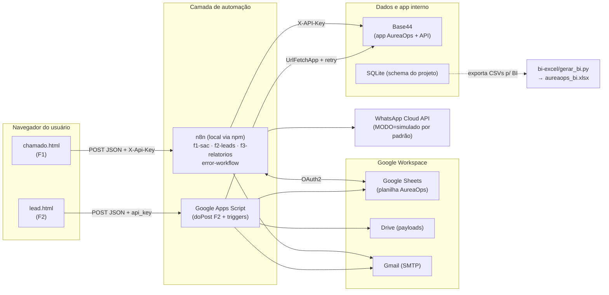

# AureaOps — Arquitetura

## Visão geral

## Responsabilidades por componente

| Componente | Responsabilidade | Por quê essa escolha |
|---|---|---|
| `frontend/` (HTML+CSS+JS puro) | Coleta com validação client-side, UUID (`request_id`), honeypot, estados de envio | Sem build/dependências — formulário precisa apenas ser servido |
| **n8n** (F1, sync F2, F3) | Webhook público com validação, gravação dupla (Sheets+Base44), SLA horário, relatórios, error workflow global | Motor principal da vaga; JSON exportável versionável no Git |
| **Apps Script** (F2) | doPost do lead, idempotência, round-robin, Drive, follow-up D+1/D+3 | Faz parte do requisito da vaga e mora dentro do Google Workspace |
| **Google Sheets** | Registro operacional (abas leads/chamados/logs/consentimentos/pedidos) | Planilha é a "fonte da verdade operacional" num MVP sem servidor |
| **Base44** | App interno com entidades, papéis e painéis (SLA, leads) + API REST | Diferencial low-code citado na vaga |
| **SQLite** | Modelo relacional canônico, views de BI e queries de exemplo | Comprova SQL/modelagem sem infraestrutura |
| **bi-excel/** | Gera pasta de trabalho com fórmulas, tabela dinâmica, gráficos + CSVs p/ Power Query | Excel avançado exigido pela vaga, calculado (não colado) |

## Decisões técnicas (resumo executável)

1. **Quem grava o quê** — F1 grava no Sheets (OAuth2 do n8n) e no Base44 (API Key);
   F2 grava no Sheets/Drive pelo Apps Script e espelha no Base44 com retry próprio;
   o workflow `f2-leads` do n8n é a rede de segurança (lote de 15 min para
   `base44_sync=0`). Evita duplicar a escrita principal e cria resiliência.
2. **Idempotência na borda** — `request_id` gerado no navegador é a chave única
   em chamados/leads; reenvio devolve a resposta original em vez de duplicar.
3. **Contrato único de resposta** — `{sucesso, codigo, mensagem, dados, request_id}`.
   Nuance: Apps Script responde sempre HTTP 200; o front do F2 decide pelo corpo.
4. **WhatsApp com chave `MODO=simulado|real`** — mesmo fluxo, entrega por
   e-mail+log no modo simulado; Cloud API com template e checagem de opt-out no real.
5. **Logs mascarados** — e-mail/telefone nunca aparecem inteiros em logs
   (`m***@e***.com`, `***0101`); LGPD por padrão.
6. **Falha nunca é silenciosa** — error workflow global (n8n) + registro em
   `logs_integracao` + alerta imediato ao gestor.

## Variáveis de ambiente (resumo)

Ver `.env.example` — nenhuma credencial real no repositório. No n8n self-hosted,
defina as variáveis na inicialização (`N8N_...`/custom) ou em Settings → Variables;
no Apps Script, use **Script Properties** (equivalente server-side do .env).
