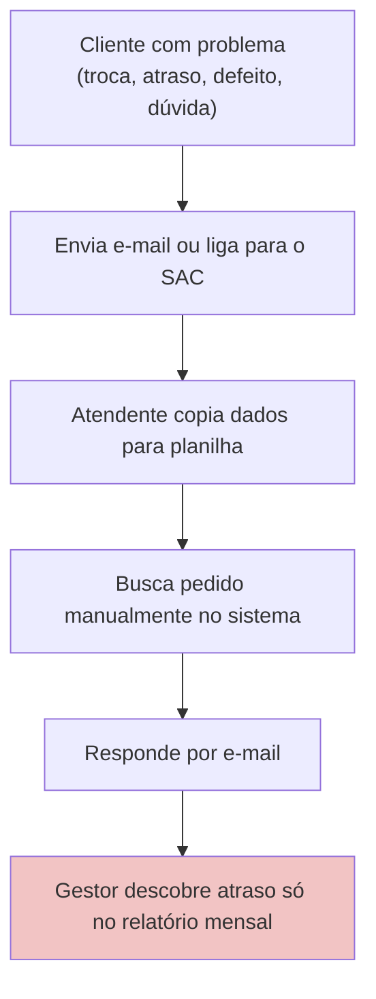
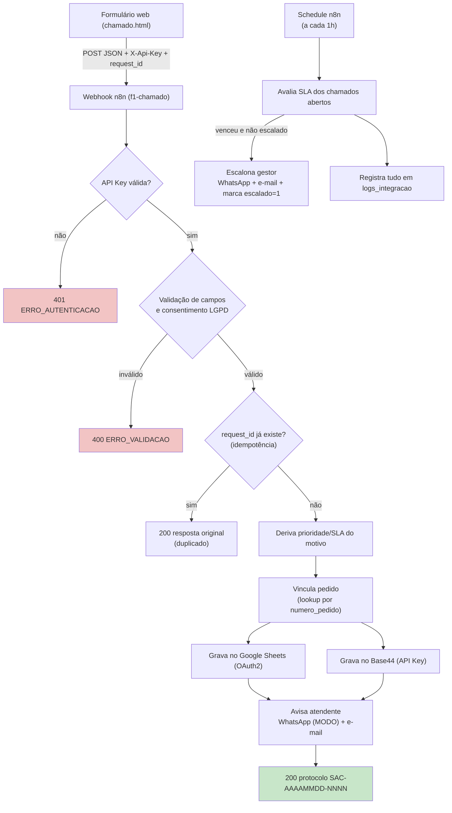
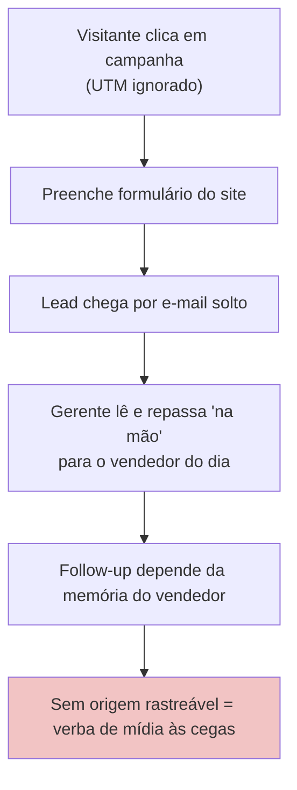
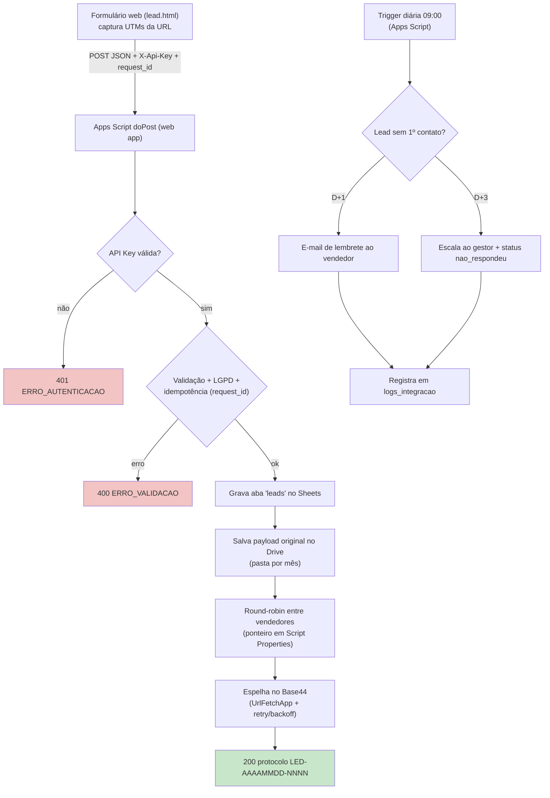
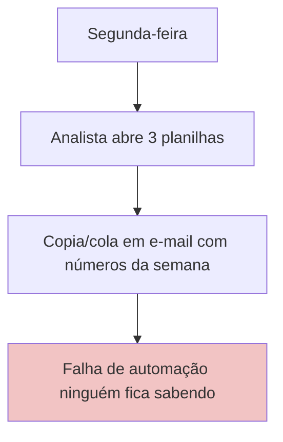
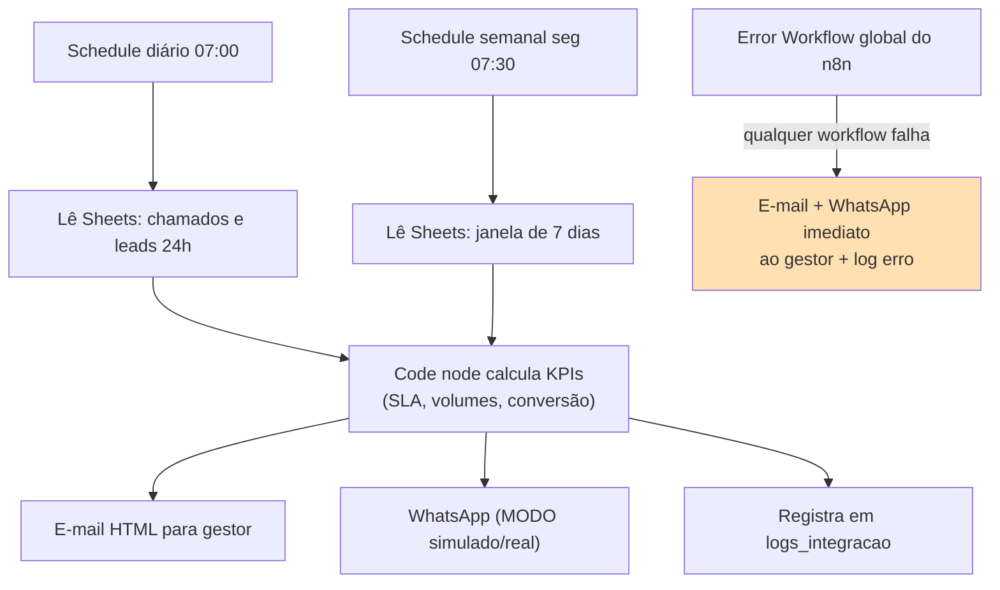
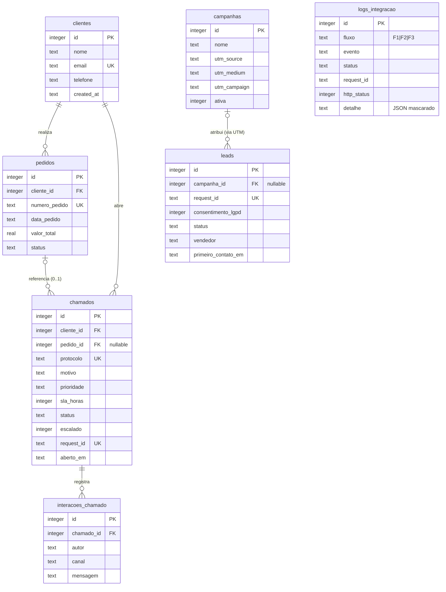

# AureaOps — Mapeamento de Processos (AS-IS x TO-BE) e Modelo de Dados

Empresa fictícia: **Aurea Home**, e-commerce D2C de casa e decoração.
Escopo do MVP: apenas os fluxos **F1 (SAC pós-venda)**, **F2 (Captação de leads)** e **F3 (Relatórios e alertas)**.

## Premissas e decisões declaradas

| # | Premissa/Decisão | Justificativa (1 linha) |
|---|---|---|
| 1 | Prioridade deriva do motivo: `defeito→alta(4h)`, `troca→media(24h)`, `atraso→media(24h)`, `duvida→baixa(72h)` | Remove decisão humana do passo crítico e torna o SLA determinístico. |
| 2 | SLA conta **horas corridas** (não úteis) | Horas úteis exigem calendário/feriados — fora do MVP; declarado como limitação. |
| 3 | Fuso único `America/Sao_Paulo` (n8n, Apps Script, Sheets) | D2C nacional com uma equipe de atendimento; evita conversões. |
| 4 | Chamado sem pedido localizado é **aceito** com `vinculo_pedido_ok=0` | Não perder contato do cliente por erro de digitação; atraso tratado depois. |
| 5 | WhatsApp nasce em **MODO=simulado** (log + e-mail) | Fluxo testável de ponta a ponta sem conta Meta; troca por 1 variável de ambiente. |
| 6 | `request_id` (UUID v4) gerado no front-end e único no banco | Idempotência: reenvio/clique duplo não duplica chamado nem lead. |

---

## F1 — Atendimento pós-venda (SAC)

### AS-IS (manual)



Dores: dado digitado várias vezes, sem vínculo garantido pedido×chamado, sem SLA observável, escalonamento reativo.

### TO-BE (automatizado)



---

## F2 — Captação de leads (Comercial + Marketing)

### AS-IS (manual)



### TO-BE (automatizado)



Observação: o espelho no Base44 usa `UrlFetchApp` com retry exponencial; o workflow **n8n `f2-leads.json`** roda uma sincronização em lote a cada 15 min como rede de segurança (leads com `base44_sync=0`).

---

## F3 — Relatórios e alertas (BI)

### AS-IS (manual)



### TO-BE (automatizado)



---

## Modelo relacional — Diagrama ER



`logs_integracao` é propositalmente **isolada** (sem FK): auditoria precisa sobreviver mesmo quando a linha de negócio é apagada, e o log nunca deve quebrar o fluxo principal.

## Como testar (banco)

```bash
cd database
sqlite3 aureaops.db < schema.sql && sqlite3 aureaops.db < seed.sql && sqlite3 aureaops.db < views.sql
sqlite3 aureaops.db < queries.sql
```

(ou `python database/validar_sql.py`, que executa tudo em memória e imprime as respostas)
